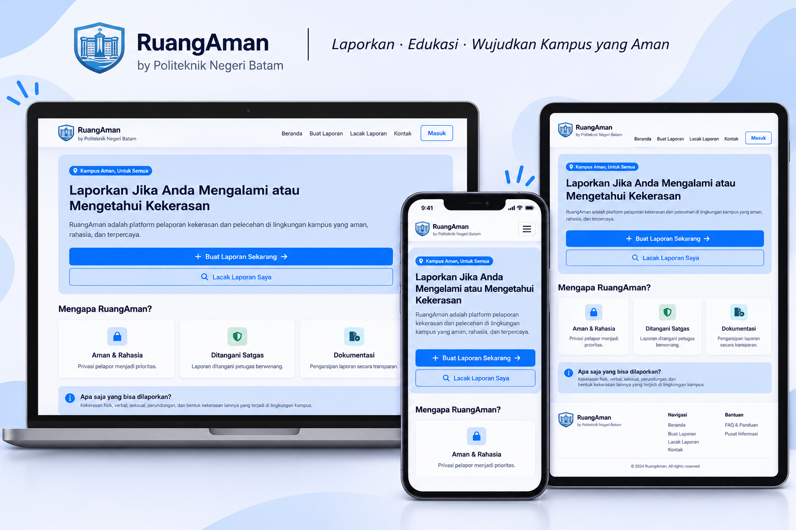

# RuangAman

RuangAman adalah platform pelaporan kekerasan dan pelecehan di lingkungan kampus Politeknik Negeri Batam. Aplikasi ini menyediakan alur antarmuka bagi pelapor untuk membuat dan melacak laporan, serta halaman bagi Satgas dan admin untuk meninjau dan menindaklanjuti kasus. Tersedia pula informasi edukasi dan kontak darurat.

## Teknologi

- HTML5 untuk struktur halaman
- CSS3 untuk gaya dan responsivitas
- JavaScript ES modules untuk perilaku antarmuka dan pemuatan komponen
- Bootstrap 5.3.8 untuk layout dan komponen UI
- Font Awesome 6.7.2 untuk ikon

Bootstrap dan Font Awesome dimuat dari CDN. Proyek ini belum memiliki backend atau database; konten dan alur yang tampil merupakan prototipe antarmuka, bukan layanan pelaporan produksi.

## Struktur utama

- `index.html` — halaman beranda
- `data-diri.html`, `detail-kejadian.html`, `pelaku-bukti.html`, `konfirmasi.html` — alur formulir laporan
- `lacak-laporan.html`, `detail-laporan.html` — pelacakan dan detail laporan
- `dashboard-pelapor.html`, `dashboard-satgas.html`, `dashboard-admin.html` — dashboard berdasarkan peran
- `edukasi.html`, `kontak-darurat.html` — informasi edukasi dan bantuan
- `components/` — komponen navigasi dan footer
- `assets/css/`, `assets/js/`, `assets/img/` — stylesheet, JavaScript, dan gambar
